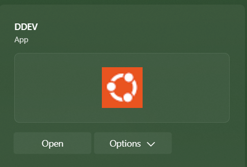
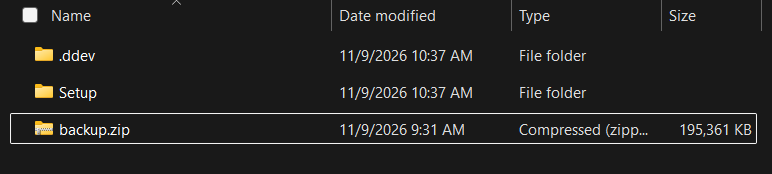

# PMN Local Dev Site Setup

## Guides Followed

### Setting Up DDEV
 - https://ddev.com/get-started/

### Importing PMN site to local dev
 - https://dev.to/mandrasch/import-wordpress-site-into-local-project-via-ddev-backwpup-18p6

## Initial Setup


### 1) Install WSL
Run the following in PowerShell terminal:

```
wsl --install --no-distribution
```

If wsl is already installed, update it before proceeding.

```
> wsl --update
```

Create the Ubuntu distro for ddev.

```
> wsl --install Ubuntu-26.04 --name DDEV
```

Verify the installation

```
> wsl -l -v
NAME                   STATE           VERSION
* DDEV                   Stopped         2
```


### 2) Install DDEV
Install DDEV from the following link


Download Link: [DDEV_Windows](https://ddev.com/download/ddev_windows_amd64_installer.exe)

Run the installer selecting the preferred `Docker CE` approach and selecting your `DDEV` distro.

In the `DDEV` terminal app or Windows Terminal `DDEV` profile, confirm that the ddev binary is installed: 

```
> ddev --version
ddev version v1.25.5
```

### 2.5) Navigating with DDEV
In the search bar, lookup `DDEV` and you'll find an application with an Ubuntu icon


Open this and it will open a specialized command line for the DDEV environment.

In this windown, run `cd /mnt/c` to access your local machines C: drive. From here you can navigate to the repo location on your base machine with:

```
cd path/to/your/project/PMN-Senior-Design
```


### 3) Pulling in PMN Site Backup
Download the backup from the [PMN site](https://publicmedianet.org/wp-admin/admin.php?page=backwpupbackups&action=delete&jobdest-top=1_FOLDER&backupfiles%5B0%5D=%2Fhome%2Fwp_9hci6e%2Fpublicmedianet.org%2Fwp-content%2Fuploads%2Fbackwpup%2Fd72fbb%2Fbackups%2F2026-11-08_17-52-39_5LLS7O5202_FILE-DBDUMP-WPPLUGIN.zip&paged=1&_wpnonce=985b7f0a7f) using the BackWPup plugin.

Navigate to the `local_wp/` folder and save this backup as `backup.zip`

Your `local_wp/` folder should look like this:


In the DDEV terminal, navigate to `local_wp/` in the repo and run `ddev start`.
This complete the inital DDEV setup for the base docker environment

While still in the Run `ddev pull backup` to import. This will take a while.

You can now run `ddev launch` to open the site locally in your browser! 🎉
